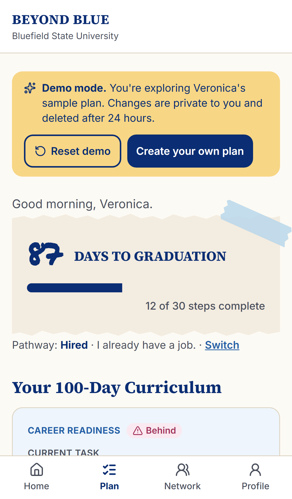
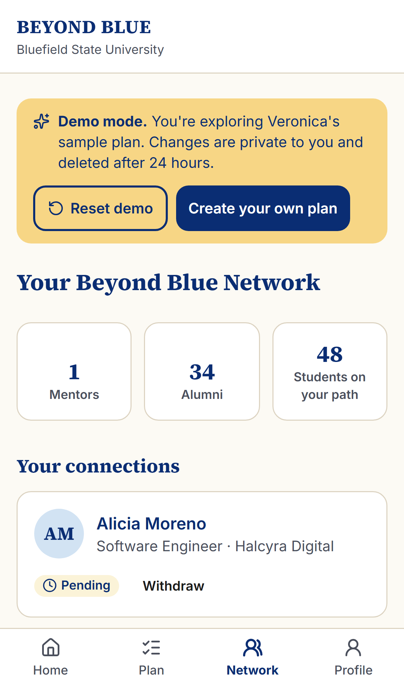
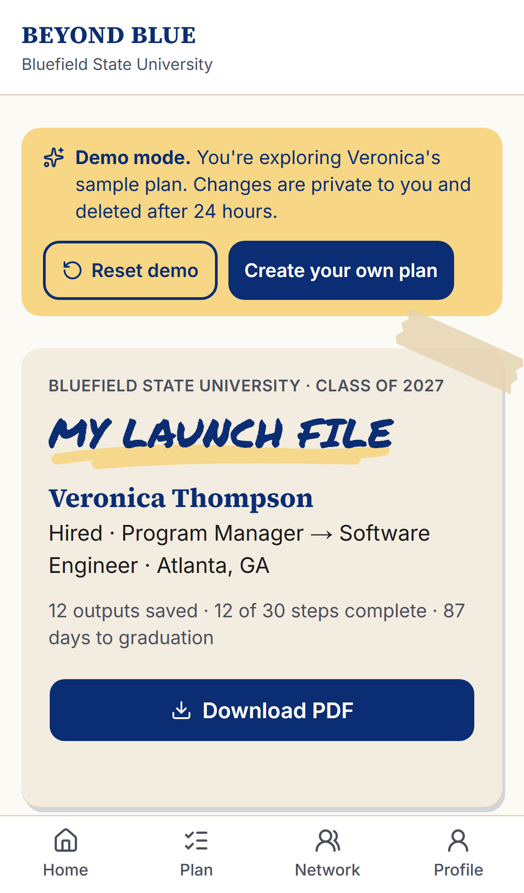
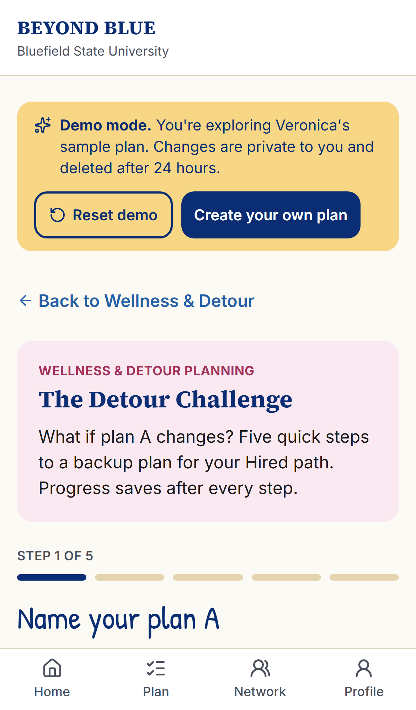
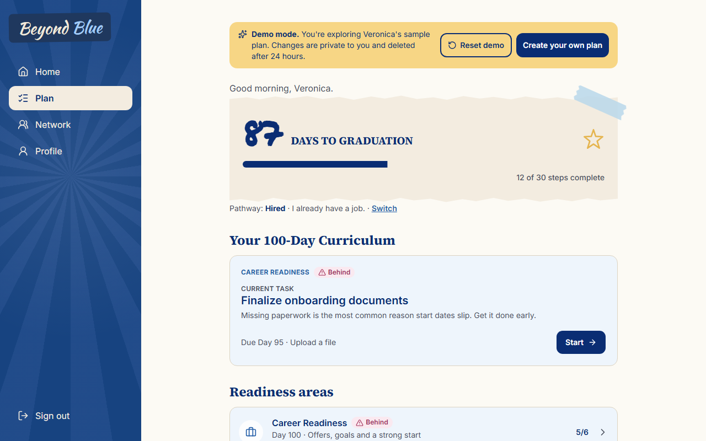
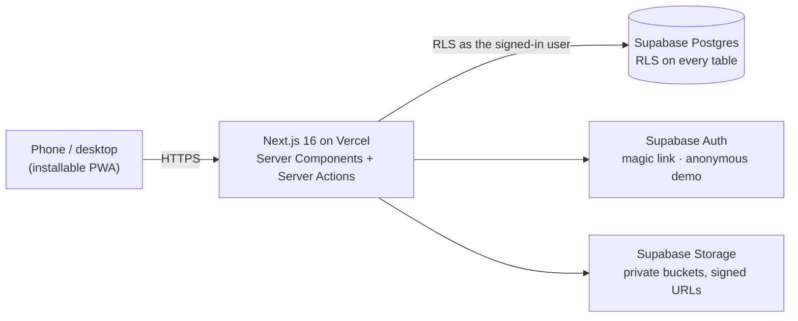

# Beyond Blue

**From Countdown to Launchpad.** Beyond Blue is a 100-day transition experience that helps every graduating senior at Bluefield State University prepare for life after college: one shared core curriculum, five personalized pathways, real-world assignments, human mentorship and targeted support.

Team Northbound · Disney on the Yard Innovation Challenge 2026 · Bluefield State University

<table>
<tr>
<td width="62%">

### Try it in one tap

**Live:** **https://beyond-blue-vert.vercel.app**

Open it on your phone, then tap **Try the demo as Veronica**. You don't need to sign up. Each demo is private to you and is deleted after 24 hours.

Add it to your home screen to use it like an app (Android: *Install*; iPhone: *Share → Add to Home Screen*).

</td>
<td width="38%" align="center">

<br><sub>Scan to open the live site</sub>
</td>
</tr>
</table>

<p align="center">
  
  
  
  
</p>

---

## Why

*"What happens after graduation?"* **68% of fourth-year students say thinking about life after graduation causes them stress** (Inside Higher Ed Student Voice, 2024). Beyond Blue turns the last 100 days into a plan. Each senior leaves with ✅ a plan, ✅ a budget, ✅ a network, ✅ a backup plan, and ✅ a place to turn.

## What you can do in the demo

| | |
|---|---|
| **Plan** | A live countdown to graduation, the current focus task, and five readiness areas: Career (Day 100), Financial (Day 75), Relocation & Life Logistics (Day 50), Network & Mentorship (Day 25), Wellness & Detour Planning (Day 0). |
| **Verified action** | Finish tasks with a real output (a file, a link or a short form). Each output goes into the Launch File. 150 tasks across 5 pathways × 5 areas. |
| **Network** | Alumni suggestions ranked by a transparent score (city, employer, industry, school, shared experience), with *why matched* shown. Send connection requests. Veronica already has one mentor connected and one request pending. |
| **Built to adapt** | **Switch pathway** at any time (Hired → Higher Education, …). A preview shows what's kept and what's already done, and no completed work is lost. |
| **Detour Challenge** | A five-step "what if plan A changes?" backup plan with prompts for each pathway. |
| **Launch File** | Everything you've built in six sections, downloadable as a branded **PDF**. |
| **Last Mile Fund** | Request a small, capped micro-grant ($250) for a cost tied to a real next step. Staff review every request with the same four-question rubric. |
| **Mentors and staff** | Mentors accept requests, log conversations and verify shared outputs. Staff work a fair, audited fund review queue. |

Five pathways: **Hired · Job Search · Higher Education · Entrepreneurship · Still Deciding.** All alumni, employers and students in the demo are fictional.

<p align="center">
  
</p>

## How it's built



- **Stack:** Next.js 16 (App Router, Cache Components) · TypeScript (strict) · Tailwind CSS v4 · shadcn/ui (Radix) · Supabase (Postgres, Auth, Storage) · react-pdf · Vitest · Playwright + axe · Vercel.
- **Security:** Row Level Security on every table, sensitive writes only through audited Postgres functions, rate limits on sign-in, the demo, uploads and connection requests, private storage with signed URLs, a strict CSP, and no bank, card or SSN fields anywhere.
- **Quality:** each PR runs lint, typecheck, unit tests, pgTAP database tests and Playwright end-to-end tests at 375 / 768 / 1280 px with axe accessibility checks. See the [accessibility report](docs/a11y-report.md).
- **Cost:** the infrastructure runs on free tiers, inside the deck's **$250** app infrastructure budget line.

More: [architecture](docs/architecture.md) · [decision records](docs/adr/) · [product requirements](docs/PRD.md) · [design system](docs/design-system.md) · [roadmap](docs/roadmap.md) · [changelog](CHANGELOG.md)

## Run it locally

Requires **Node 24** (`.nvmrc`; ≥ 22 works) and npm.

```bash
git clone https://github.com/Yine-Eng/beyond-blue.git
cd beyond-blue && git switch develop
npm install
cp .env.example .env.local   # fill in Supabase values; never commit this file
npm run dev                  # http://localhost:3000
```

| Command | |
|---|---|
| `npm run lint` · `npm run typecheck` | Quality gates |
| `npm test` | Unit tests (Vitest) |
| `npm run test:e2e` | Playwright at 375 / 768 / 1280 px with axe |
| `npm run db:test` | Database (pgTAP) tests against a local Supabase |
| `npm run build` | Production build |

## How we worked

Every change went issue → branch → pull request → CI → squash merge, with tagged releases for each milestone (v0.1.0 to v1.0.0). See [git workflow](docs/git-workflow.md) · [contributing](CONTRIBUTING.md) · [security](SECURITY.md).

## Built by Bluefield

The app is built as paid applied learning for Bluefield State Computer Science students.

- **Software engineering:** Sampson ([@Yine-Eng](https://github.com/Yine-Eng))
- **Research, pitch and design:** Team Northbound

## License

[MIT](LICENSE)
