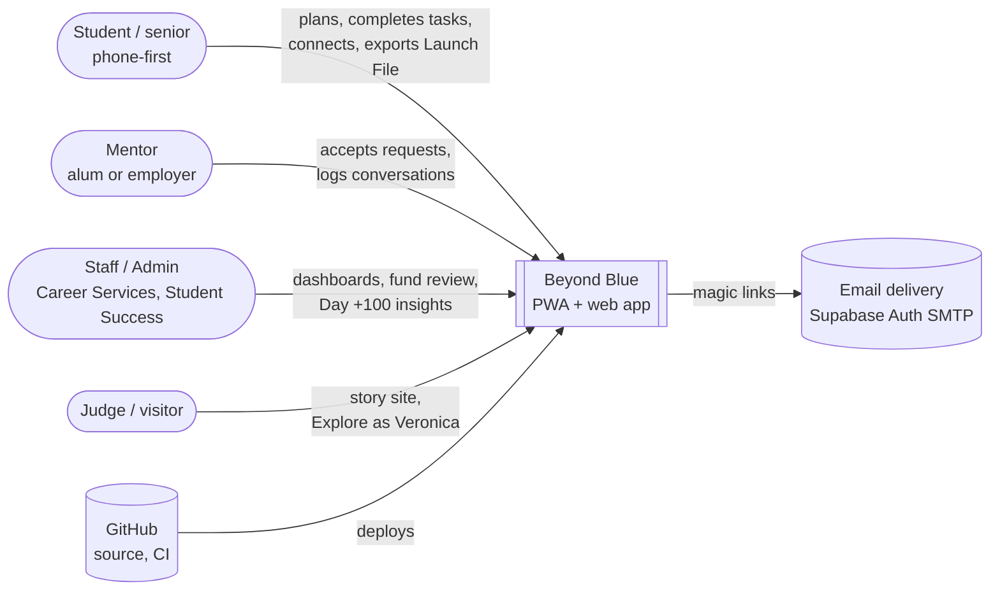
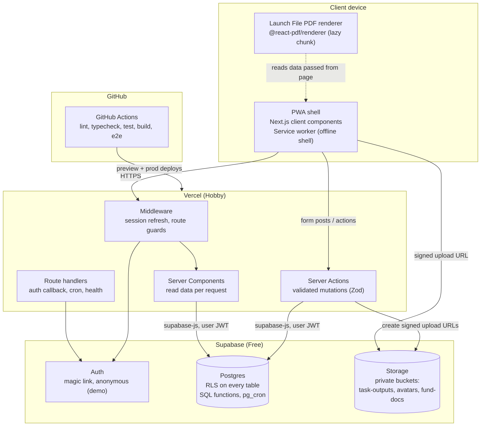
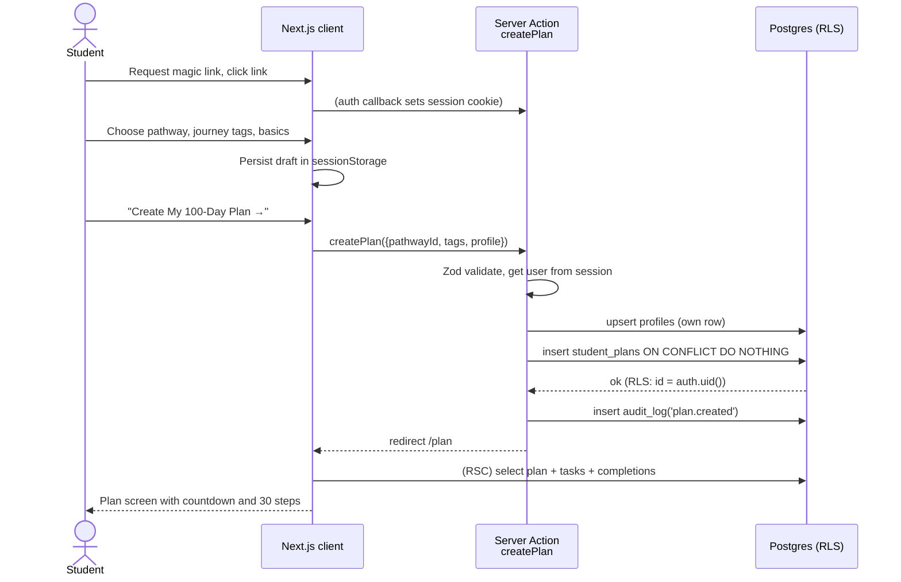
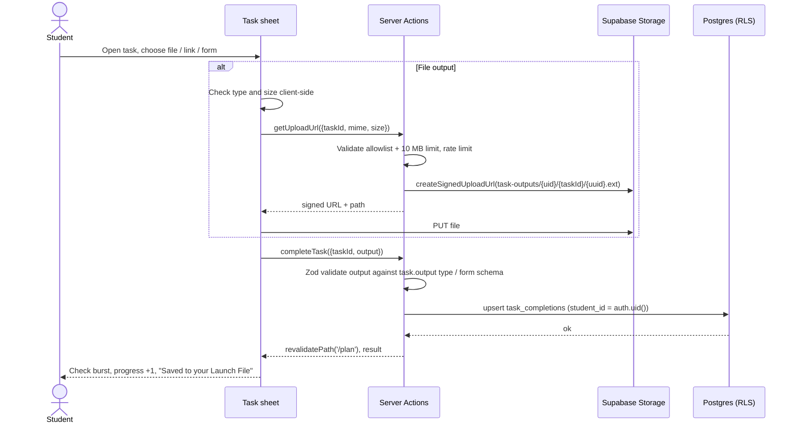
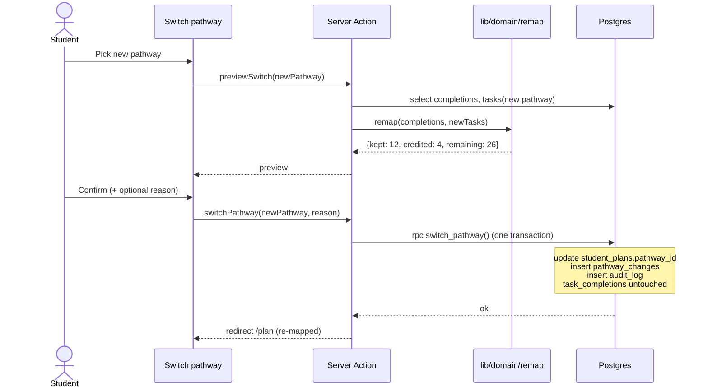
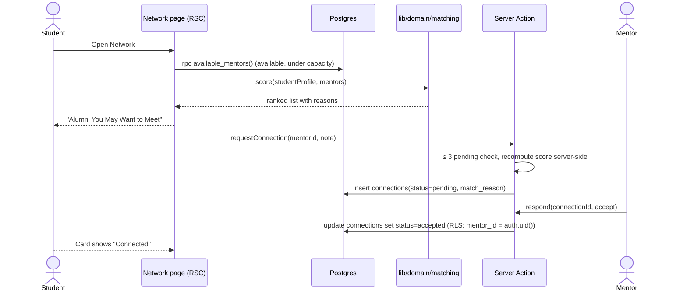
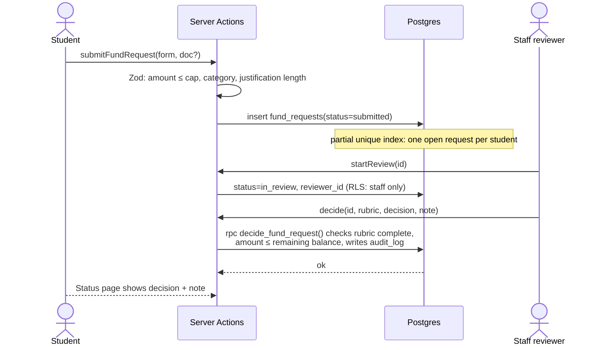
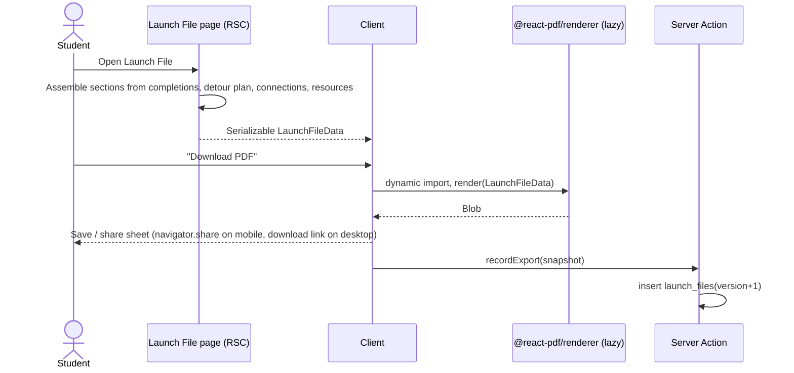

# Beyond Blue: Architecture

> Status: **Draft for review**. Decisions referenced here are recorded in [`docs/adr/`](adr/).

## 1. Overview

Beyond Blue is a mobile-first, installable web app (PWA) built with **Next.js (App Router) + TypeScript** on **Vercel**, backed by **Supabase** (Postgres, Auth, Storage). Server Components render data on the server, **Server Actions** handle every mutation, and **Postgres Row Level Security (RLS)** is the final authority on who can read or write what.

| Concern | Choice | ADR |
|---|---|---|
| Framework | Next.js (App Router, latest stable at scaffold time, pinned), TypeScript strict | [0001](adr/0001-tech-stack.md) |
| UI | Tailwind CSS v4, shadcn/ui (Radix), Framer Motion, lucide-react | [0001](adr/0001-tech-stack.md) |
| Auth | Supabase Auth: email magic link; anonymous sign-in for demo mode only | [0002](adr/0002-auth.md) |
| Data access | Server Components for reads, Server Actions for writes, Zod at every boundary. No TanStack Query. | [0003](adr/0003-data-access-pattern.md) |
| PDF | `@react-pdf/renderer`, generated client-side and lazy-loaded | [0004](adr/0004-pdf-export.md) |
| Curriculum | Typed TypeScript content in `src/content/curriculum`, validated with Zod, upserted to Postgres by a seed script | [0005](adr/0005-curriculum-as-code.md) |
| Hosting | Vercel Hobby (prod from `main`, preview per PR) + Supabase Free | [0001](adr/0001-tech-stack.md) |

## 2. Context and containers

### 2.1 System context



### 2.2 Containers



Key points:
- **The user's JWT is used for every query**, so RLS applies to every request. The Supabase **secret key** (`SUPABASE_SECRET_KEY`, which replaces the legacy service-role key) is used only in two server-only places: the demo-mode seeder and the curriculum seed script. It is never shipped to the browser.
- **File uploads go directly from the browser to Supabase Storage** using short-lived signed upload URLs created by a Server Action. This keeps large payloads off Vercel functions (Hobby has a 4.5 MB request limit).
- **Static and public content** (story site, curriculum metadata) is statically rendered and cached at the edge.

### 2.3 Source layout (planned)

```
src/
  app/
    (marketing)/            # public story site, statically rendered
    (auth)/sign-in, auth/callback
    (app)/                  # authenticated shell: bottom nav / sidebar
      home/ plan/ plan/[area]/ tasks/[taskId]/ network/ profile/
      launch-file/ detour/ fund/ switch-pathway/ day-plus-100/
    (mentor)/mentor/
    (staff)/staff/          # dashboard, fund review, insights, cohorts
    dev/ui/                 # UI kit page (non-production)
    manifest.ts
  components/
    ui/                     # shadcn/ui primitives (generated, themed)
    scrapbook/              # PaperCard, Tape, SpiralEdge, Doodle, MarkerHeading
    plan/ network/ launch-file/ ...
  content/
    curriculum/             # typed pathway × area × task data (source of truth)
    copy/                   # landing page copy, FAQ, budget table
  lib/
    supabase/               # server/browser clients, generated types
    domain/                 # pure logic: countdown, matching, plan, progress, remap
    validation/             # Zod schemas shared by forms and actions
    actions/                # Server Actions grouped by feature
supabase/
  migrations/               # SQL migrations (schema, RLS, functions)
  seed.sql                  # reference data only (pathways, areas)
  tests/                    # pgTAP RLS policy tests
scripts/
  seed-curriculum.ts        # upserts src/content/curriculum into Postgres
```

`lib/domain` is pure TypeScript with no I/O so countdown, matching, progress and remap logic are fully unit-testable.

## 3. Data model

### 3.1 ERD

```mermaid
erDiagram
    cohorts ||--o{ profiles : "has students"
    profiles ||--o| student_plans : "has current plan"
    pathways ||--o{ student_plans : "chosen in"
    pathways ||--o{ tasks : "defines"
    readiness_areas ||--o{ tasks : "groups"
    profiles ||--o{ task_completions : "completes"
    tasks ||--o{ task_completions : "completed by"
    profiles ||--o{ pathway_changes : "history"
    profiles ||--o| mentor_profiles : "is mentor"
    profiles ||--o{ connections : "requests (student)"
    mentor_profiles ||--o{ connections : "receives"
    connections ||--o{ mentor_notes : "logs"
    profiles ||--o{ detour_plans : "builds"
    profiles ||--o{ launch_files : "exports"
    profiles ||--o{ fund_requests : "submits"
    profiles ||--o{ day_plus_100_surveys : "answers"
    readiness_areas ||--o{ resources : "tagged"
    pathways ||--o{ resources : "tagged"
    profiles ||--o{ audit_log : "acts"

    cohorts {
        uuid id PK
        text name "Spring 2027"
        int class_year
        date graduation_date
        text time_zone "America/New_York"
        bool is_demo
    }
    profiles {
        uuid id PK "= auth.users.id"
        user_role role "student|mentor|staff|admin"
        uuid cohort_id FK
        text preferred_name
        int class_year
        text major
        text school
        text destination_role
        text target_city
        text[] journey_tags
        text avatar_path
        bool is_demo
        timestamptz last_active_at
    }
    pathways {
        text id PK "hired|job_search|higher_ed|entrepreneurship|still_deciding"
        text name
        text self_description
        text accent_token
        int sort_order
    }
    readiness_areas {
        text id PK "career|financial|relocation|network|wellness"
        text name
        int milestone_day "100|75|50|25|0"
        int opens_at_day
        text color_token
    }
    tasks {
        text id PK "hired.financial.budget-90"
        text pathway_id FK
        text area_id FK
        text title
        text why_it_matters
        int due_day_offset "days before graduation"
        output_type output_type "file|link|form"
        jsonb form_schema "for form outputs"
        text equivalence_key "shared across pathways"
        text launch_file_section
        int sort_order
        int content_version
    }
    student_plans {
        uuid student_id PK
        text pathway_id FK
        timestamptz created_at
        timestamptz updated_at
    }
    task_completions {
        uuid id PK
        uuid student_id FK
        text task_id FK
        text pathway_id_at_completion
        output_type output_type
        text output_url
        text output_path "storage object"
        jsonb output_data "form answers"
        bool shared_with_mentors
        uuid verified_by FK
        timestamptz verified_at
        timestamptz completed_at
    }
    pathway_changes {
        uuid id PK
        uuid student_id FK
        text from_pathway_id
        text to_pathway_id
        text reason
        int completed_kept
        int credited_in_new
        timestamptz changed_at
    }
    mentor_profiles {
        uuid id PK
        uuid user_id FK "null for fictional alumni"
        text display_name
        int grad_year
        text role_title
        text employer
        text industry
        text city
        text grad_school
        text[] pathways
        text[] journey_tags
        text bio
        int capacity
        bool is_available
        bool is_seeded_fictional
    }
    connections {
        uuid id PK
        uuid student_id FK
        uuid mentor_id FK
        connection_status status "pending|accepted|declined|withdrawn"
        text match_reason
        int match_score
        text note
        timestamptz requested_at
        timestamptz responded_at
    }
    mentor_notes {
        uuid id PK
        uuid connection_id FK
        date met_on
        text topic
        text notes
    }
    detour_plans {
        uuid id PK
        uuid student_id FK
        text plan_a
        text detour_type
        text[] warning_signs
        jsonb plan_b_actions
        int min_monthly_budget
        int current_step
        timestamptz completed_at
    }
    launch_files {
        uuid id PK
        uuid student_id FK
        int version
        jsonb snapshot
        timestamptz exported_at
    }
    fund_requests {
        uuid id PK
        uuid student_id FK
        fund_category category
        int amount_cents
        text next_step
        text justification
        text document_path
        date needed_by
        fund_status status "submitted|in_review|needs_info|approved|declined"
        jsonb rubric
        uuid reviewer_id FK
        text reviewer_notes
        timestamptz decided_at
    }
    day_plus_100_surveys {
        uuid id PK
        uuid student_id FK
        text pathway_id
        text outcome_status
        int usefulness "1-5"
        int stress_vs_graduation "1-5"
        text most_useful
        text improve
        bool opt_in_mentor
        bool opt_in_session
        bool opt_in_fund
        timestamptz submitted_at
    }
    resources {
        uuid id PK
        text title
        text url
        text pathway_id "nullable = all"
        text area_id "nullable = all"
        text kind
    }
    audit_log {
        bigint id PK
        uuid actor_id
        text action
        text entity
        text entity_id
        jsonb diff
        timestamptz at
    }
```



### 3.2 Notes on the model
- **`mentors` / `mentor_profiles`:** a mentor is a `profiles` row with `role = 'mentor'` plus a `mentor_profiles` row linked by `user_id`. Connections reference `mentor_profiles.id`, so fictional alumni (no account, `user_id` null) work the same way. A separate `mentors` table would duplicate identity, so it is omitted. Seeded demo alumni are fictional and flagged with `is_seeded_fictional`.
- **`student_plans`** holds the student's *current* pathway. The plan itself is derived: `tasks WHERE pathway_id = plan.pathway_id` plus the student's completions. Nothing is copied per student, so curriculum fixes reach everyone immediately and pathway switches are cheap.
- **`task_completions`** is never deleted on a pathway switch (principle 5). `pathway_id_at_completion` labels the output in the Launch File.
- **`equivalence_key`** links equivalent tasks across pathways (e.g. every pathway has a `budget-90` task in Financial Readiness). This is what lets a switch credit existing work.
- **`launch_files`** stores export snapshots (for metrics and a stable record of what was exported). The live Launch File page is always derived from current completions.
- **Money** is stored as integer cents. **No** bank, card or SSN fields exist anywhere in the schema.
- Enums: `user_role`, `output_type`, `connection_status`, `fund_category`, `fund_status`.
- Unique constraints: `task_completions (student_id, task_id)`, `connections (student_id, mentor_id)` for open states, one open `fund_requests` per student (partial unique index), `day_plus_100_surveys (student_id)`.

### 3.3 Curriculum shape (TypeScript)

```ts
// src/content/curriculum/types.ts (planned)
export type PathwayId = 'hired' | 'job_search' | 'higher_ed' | 'entrepreneurship' | 'still_deciding';
export type AreaId = 'career' | 'financial' | 'relocation' | 'network' | 'wellness';
export type OutputType = 'file' | 'link' | 'form';

export interface TaskDef {
  slug: string;                 // unique within pathway; id = `${pathway}.${area}.${slug}`
  title: string;
  whyItMatters: string;
  dueDayOffset: number;         // days before graduation, 0..100
  output: { type: 'file'; accept: string[] } | { type: 'link' } | { type: 'form'; formId: FormId };
  equivalenceKey?: string;      // shared across pathways for credit on switch
  launchFileSection: LaunchFileSection;
  support?: SupportPartner[];   // 'career_services' | 'alumni' | 'financial_pro' | 'counseling' | ...
}

export type Curriculum = Record<PathwayId, Record<AreaId, TaskDef[]>>; // 5 × 5 × 6 = 150 tasks
```

A Zod schema validates the whole curriculum in a unit test (exactly 6 tasks per pathway × area, unique ids, due offsets inside the area window, every `formId` exists, every pathway has the shared equivalence keys).

## 4. Key flows

### 4.1 Onboarding → plan generation



### 4.2 Completing a task with an output



### 4.3 Switching pathway



**Remap rule.** A task in the new pathway counts as complete if the student completed it directly, or completed any task with the same `equivalence_key`. Completions with no equivalent stay in the Launch File and in `pathway_changes.completed_kept`, but don't count toward the new 30. Progress = credited / 30.

### 4.4 Mentor matching and connection



### 4.5 Last Mile Fund request → review



### 4.6 Launch File export



## 5. Matching logic

Transparent, deterministic, explainable. Implemented as a pure function in `src/lib/domain/matching.ts` with unit tests for every rule.

```ts
const WEIGHTS = {
  sameCity: 30,          // mentor.city === student.target_city (normalized)
  sameEmployer: 30,      // mentor.employer === student's offer employer (Hired)
  sameGradSchool: 30,    // mentor.grad_school === student's target program school (Higher Ed)
  sameIndustry: 20,      // mentor.industry === industry derived from destination role / major
  samePathway: 10,       // mentor lists the student's pathway as one they support
  sharedJourneyTag: 8,   // per shared tag, max 3 tags (24)
} as const;

score = Σ applicable weights           // 0..144
reasons = top 3 matched rules, in weight order, rendered as copy:
  sameCity        → "Also lives in {city}"
  sameEmployer    → "Works at {employer}"
  sameGradSchool  → "Went to {school}"
  sameIndustry    → "Works in {industry}"
  samePathway     → "Mentors {pathway} students"
  sharedJourneyTag→ "Also {tag}" (e.g. "Also first-gen")
```

Rules:
- Only mentors with `is_available = true` and active mentees below `capacity` are scored.
- Minimum score to be suggested: **20** (so every suggestion has at least one substantive reason).
- Ties broken by fewest active mentees, then most recent activity.
- Journey tags are only used if the **mentor** has opted to display that tag. The student's tags are never shown to the mentor before the student sends a request.
- The score and the reason string are stored on `connections` at request time, so staff can audit matching later.

## 6. Countdown logic

Time-zone-safe and derived from the cohort's graduation date. Implemented in `src/lib/domain/countdown.ts`.

- `cohorts.graduation_date` is a **calendar date** (no time), and `cohorts.time_zone` is an IANA zone (default `America/New_York`, BSU's zone).
- `today` = the current calendar date **in the cohort time zone**, computed with `Intl.DateTimeFormat` / `@date-fns/tz` on the server for each request. The client never trusts device time for gating.
- `daysToGraduation = differenceInCalendarDays(graduation_date, today)`. Calendar-day difference avoids DST off-by-one errors that come from dividing milliseconds by 86,400,000.
- Stages: `> 100` "Pre-program", `100..1` countdown, `0` Launchpad (Day 0), `< 0` "Day +N".
- Server-rendered countdown is the source of truth. A client component re-checks at local midnight so an open tab rolls over without a reload.
- **Demo cohort:** graduation date is computed as session start + 87 days so the demo always reads "87 Days to Graduation".

**Readiness area windows** (proposed, see open questions):

| Area | Milestone | Opens at | Tasks due between |
|---|---|---|---|
| Career Readiness | Day 100 | Day 100 | Day 100 → 76 |
| Financial Readiness | Day 75 | Day 75 | Day 75 → 51 |
| Relocation & Life Logistics | Day 50 | Day 50 | Day 50 → 26 |
| Network & Mentorship | Day 25 | Day 25 | Day 25 → 1 |
| Wellness & Detour Planning | Day 0 | Day 25 | Day 25 → 0 (Detour Challenge due Day 0) |

- A task is **active** when `opens_at_day ≥ daysToGraduation ≥ due_day_offset` of its area window; **behind** when `daysToGraduation < due_day_offset` and incomplete; **upcoming** otherwise. Nothing is hard-locked, so students can always work ahead.
- **Expected pace** for at-risk detection: `expected = count(tasks with due_day_offset ≥ daysToGraduation)`. A student is behind if `expected - completed ≥ 5`.

## 7. Security

### 7.1 Principles
- **Deny by default.** RLS is enabled on every table in `public`. No table is readable without a policy.
- **Defense in depth.** Server Actions check role and ownership *and* RLS enforces it again.
- **Minimal PII.** Name, email, major, class year, target city, journey tags. **Never** SSNs, bank or card numbers, government IDs or exact salaries.
- **Secret key** (`SUPABASE_SECRET_KEY`) only in server-only modules (`import 'server-only'`), used for demo seeding and curriculum seeding.

### 7.2 Role helpers

```sql
-- security definer, stable; reads role without RLS recursion
create function app.current_role() returns user_role ...;
create function app.is_staff() returns boolean ...;   -- staff or admin
create function app.is_my_mentor(student uuid) returns boolean ...; -- accepted connection exists
```

`profiles.role` cannot be changed by its owner: `UPDATE` is granted on profiles only for an explicit column list that excludes `role`, `cohort_id` and `is_demo`. Role changes go through an admin-only RPC that writes to `audit_log`.

### 7.3 RLS policy matrix

| Table | Student | Mentor | Staff / Admin |
|---|---|---|---|
| `profiles` | R/W own row (safe columns) | R own; R mentee basics if `is_my_mentor` | R all; role change via RPC (admin) |
| `cohorts`, `pathways`, `readiness_areas`, `tasks`, `resources` | R | R | R/W |
| `student_plans` | R/W own | R mentees | R all |
| `task_completions` | R/W own | R mentees' rows where `shared_with_mentors`; update `verified_*` only | R all; update `verified_*` |
| `pathway_changes` | R own; insert via RPC | - | R all |
| `mentor_profiles` | R available mentors (public columns via view) | R/W own | R/W all |
| `connections` | R own; insert as self (pending); update own to `withdrawn` | R/W where `mentor_id = me` (accept/decline) | R all |
| `mentor_notes` | R notes on own connections | R/W own connections | R all |
| `detour_plans`, `launch_files` | R/W own | R mentees' if shared | R all |
| `fund_requests` | insert own; R own; update own only while `needs_info` | - | R all; decide via RPC |
| `day_plus_100_surveys` | insert/R own | - | R aggregates only via view with n ≥ 5 suppression |
| `audit_log` | - | - | R (admin); insert only via triggers/RPCs |
| `storage: task-outputs` | R/W `{uid}/*` | R mentees' shared paths | R all |
| `storage: avatars` | R/W `{uid}/*` | R | R |
| `storage: fund-docs` | W/R `{uid}/*` | - | R all |

"Students on your path" counts come from a `security definer` function that returns only an integer.

RLS policies are tested with **pgTAP** in `supabase/tests/` (run in CI against a local Supabase via the CLI): for each table, assert that student A cannot read or write student B's rows and that a student cannot escalate their role.

### 7.4 Input, files and abuse
- **Validation:** every Server Action parses input with a Zod schema shared with the form. Text fields have max lengths. URLs must be `https:`.
- **Uploads:** MIME allowlist (`application/pdf`, `image/png`, `image/jpeg`, `image/webp`, `application/vnd.openxmlformats-officedocument.wordprocessingml.document`), 10 MB max (2 MB for demo users), enforced in the action **and** in bucket config. Object names are server-generated UUIDs. Buckets are private and served through short-lived signed URLs.
- **Rate limiting:** Supabase Auth's built-in limits for magic links and anonymous sign-ins, plus a Postgres-backed fixed-window limiter (`app.rate_limit(key, max, window)`) called from sensitive actions (upload URLs, connection requests, fund requests, demo session creation). No extra paid service is needed.
- **Headers:** strict CSP (self + Supabase origin), `Referrer-Policy: strict-origin-when-cross-origin`, `X-Content-Type-Options`, `Permissions-Policy`. Server Actions have Next.js built-in origin checks.
- **Secrets:** `.env.local` (git-ignored) plus a committed `.env.example`. Vercel env vars per environment. The GitHub secret-scanning push protection is enabled.
- **Audit log:** role changes, pathway switches, fund decisions, verifications and demo resets.
- **Data retention:** demo users are deleted by `pg_cron` after 24 h. Real student data retention policy to be confirmed with BSU (FERPA).

## 8. Demo mode

1. "Try the demo as Veronica" calls a Server Action that rate-limits by IP, then calls `supabase.auth.signInAnonymously()`.
2. A server-only seeder (secret key) clones the **Veronica seed** into the new anonymous user's rows: profile (`is_demo = true`), demo cohort (graduation = now + 87 days), Hired plan, 12 completions with sample outputs (pre-uploaded shared sample files), one pending and one accepted connection with fictional alumni, a partial Detour plan.
3. The user lands on `/plan`. The demo banner offers "Reset demo" (re-run the seeder) and "Create your own plan" (sign out, go to sign-in).
4. `pg_cron` deletes demo users and their storage objects older than 24 h.
5. **Staff demo:** a separate seeded demo cohort of ~60 fictional students feeds a read-only staff dashboard view for judges.

Because demo users are ordinary authenticated users with `is_demo = true`, demo mode exercises the exact same code paths and RLS policies as real users.

## 9. Accessibility (WCAG 2.1 AA)
- **Contrast:** every text/background pair in the palette is checked (see `docs/design-system.md` §2.3). `orange-500` and `blue-500` fail AA for body text on cream, so darker text tokens (`orange-700`, `blue-700`, …) are defined for text and the brighter tones are used for fills, large display text and decoration only.
- **Semantics:** landmark regions, one `h1` per page, Radix primitives for dialogs, tabs, radio groups and accordions.
- **Keyboard:** everything reachable and operable. Visible focus ring (3 px `gold-400` outline with a navy offset, ≥ 3:1 against both cream and royal).
- **Motion:** all Framer Motion animations are wrapped in a `useReducedMotion` guard. Confetti and countdown ticks become instant state changes.
- **Touch targets:** ≥ 44 × 44 px. Bottom nav respects safe-area insets.
- **Scrapbook decoration** (tape, doodles, torn edges) is `aria-hidden` and never carries meaning on its own. Handwritten display fonts are used only for short headlines, never for body copy.
- **Testing:** `eslint-plugin-jsx-a11y`, `@axe-core/playwright` in e2e on every key screen, and a manual VoiceOver/TalkBack pass at M6.

## 10. Performance budget
- **Lighthouse (mobile) ≥ 90** for Performance, Accessibility, Best Practices and SEO, checked with Lighthouse CI on the preview deployment.
- **Budgets:** LCP ≤ 2.5 s, CLS ≤ 0.1, INP ≤ 200 ms on a Moto G-class device; first-load JS ≤ 170 KB gzipped for app routes.
- **Fonts:** `next/font` with subsetting and `display: swap`. Display fonts are loaded only on routes that use them.
- **Images:** `next/image`, AVIF/WebP, SVG for doodles and textures (paper texture as a tiny tiled image or CSS gradient).
- **Code splitting:** PDF renderer, confetti and charts are dynamically imported. Framer Motion uses `LazyMotion` with `domAnimation`.
- **Data:** Server Components fetch in parallel. Static marketing pages and curriculum metadata are cached.

## 11. Scalability: "Built to Last"
- **Reusable curriculum.** Content is versioned data (`content_version`), not code in components. Next year's program updates content through a PR (or, later, a staff content editor) without touching screens.
- **New cohorts.** A new graduating class is one `cohorts` row with a graduation date. Spring and fall commencements, and any future partner campus, run in parallel.
- **Growing alumni network.** Every Day +100 opt-in becomes a mentor profile, so the matching pool grows each year and the next senior starts with more than the class before.
- **Cost.** At pilot scale (~300 seniors, ~50 mentors) the app fits comfortably in Vercel Hobby and Supabase Free (500 MB DB, 1 GB storage, 50K MAU). Upgrading to Supabase Pro ($25/mo) is the first paid step and is only needed beyond pilot scale or when daily backups are required. Note: Supabase Free pauses projects after 7 days of inactivity, which a keep-alive cron prevents during judging.
- **Maintainability.** Built by Bluefield: strict types, documented ADRs, pure domain logic and tests make it practical for future BSU CS student teams to maintain.

## 12. Observability
- Vercel logs and Speed Insights / Web Analytics (free tier).
- Structured server logging (`{action, userId(hash), ok, ms}`) with no PII in logs.
- Error boundary per route segment with a friendly scrapbook error state.

## 13. ADR index
| # | Decision |
|---|---|
| [0001](adr/0001-tech-stack.md) | Tech stack and hosting |
| [0002](adr/0002-auth.md) | Authentication: magic link + anonymous demo sessions |
| [0003](adr/0003-data-access-pattern.md) | Data access: Server Components + Server Actions + RLS |
| [0004](adr/0004-pdf-export.md) | Launch File PDF: client-side @react-pdf/renderer |
| [0005](adr/0005-curriculum-as-code.md) | Curriculum as typed, versioned content |
