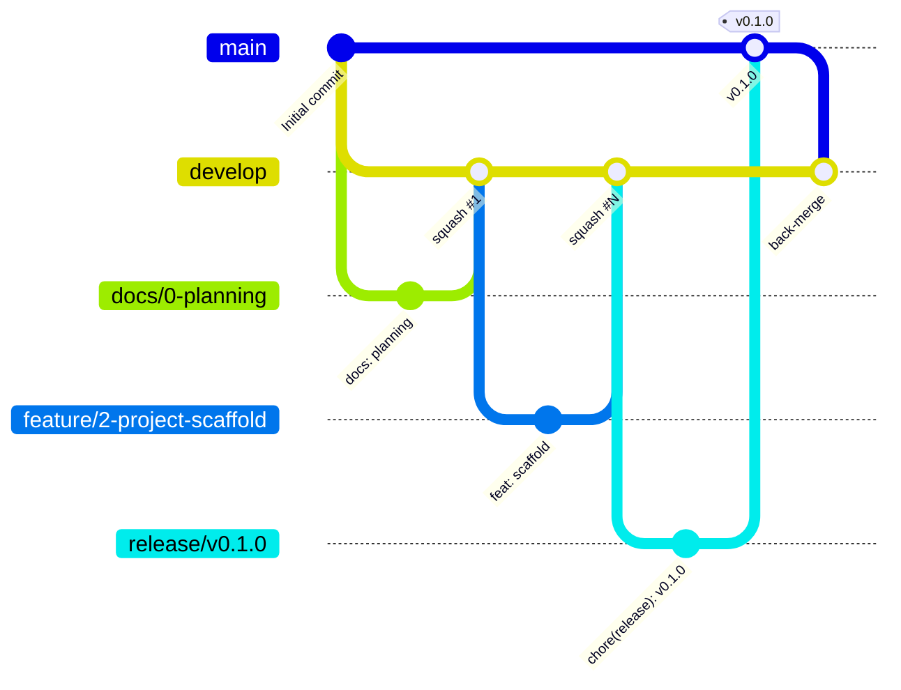

# Beyond Blue: Git and Team Workflow

> How work moves from an idea to production. The repo is run like a real team's: **issue → branch → PR → CI → squash-merge → release PR → tag**.

## 1. Authorship and credit

- **Sampson (`Yine-Eng`) is the sole software engineer.** Every commit, push and PR comes from that account. Authors, dates and contributions are never faked.
- Commits written with AI assistance carry a `Co-Authored-By` trailer for transparency.
- The rest of **Team Northbound** (research, pitch, design) is credited in the README.
- What makes the repo professional is the **process**, not commit volume.

## 2. Branches



| Branch | Purpose | Created from | Merges into | How |
|---|---|---|---|---|
| `main` | Production (Vercel prod). Protected. | — | — | Release and hotfix PRs only |
| `develop` | Integration, **default branch**. Protected. | `main` | `main` via release PR | — |
| `feature/<issue#>-<slug>` | One feature | `develop` | `develop` | Squash merge |
| `fix/<issue#>-<slug>` | Bug fix | `develop` | `develop` | Squash merge |
| `chore/<issue#>-<slug>` | Tooling, deps, config | `develop` | `develop` | Squash merge |
| `docs/<issue#>-<slug>` | Docs only | `develop` | `develop` | Squash merge |
| `release/vX.Y.0` | Milestone release prep (version bump, changelog) | `develop` | `main` | **Merge commit** |
| `hotfix/vX.Y.Z-<slug>` | Urgent production fix | `main` | `main`, then back-merge to `develop` | Merge commit |

Rules:
- Branch names are lowercase kebab-case, start with the issue number when one exists (`feature/12-plan-countdown`).
- Keep branches short-lived (ideally ≤ 2 days). Rebase on or merge from `develop` if it moves.
- Merged branches are auto-deleted by GitHub.

## 3. Commits: Conventional Commits

Format: `type(scope): summary` in the imperative mood, ≤ 72 characters, lower-case summary, no trailing period.

```
feat(plan): add readiness area cards
fix(auth): handle expired magic links
docs(adr): record pdf export decision
chore(deps): bump next to 16.x
test(network): cover matching tie-breaks
```

| Type | When |
|---|---|
| `feat` | New user-facing capability |
| `fix` | Bug fix |
| `docs` | Documentation only |
| `style` | Formatting, no logic change |
| `refactor` | Code change that neither fixes a bug nor adds a feature |
| `perf` | Performance improvement |
| `test` | Adding or fixing tests |
| `build` | Build system or dependencies |
| `ci` | CI configuration |
| `chore` | Other maintenance |
| `revert` | Reverts a previous commit |

**Scopes:** `landing`, `auth`, `onboarding`, `plan`, `tasks`, `profile`, `network`, `pathways`, `detour`, `launch-file`, `fund`, `staff`, `day-plus-100`, `demo`, `pwa`, `a11y`, `ui`, `db`, `content`, `deps`, `ci`, `release`, `adr`, `repo`.

- Breaking changes: `feat(db)!: rename tasks.offset` plus a `BREAKING CHANGE:` footer.
- Reference issues in the body or footer: `Refs #12` / `Closes #12`.
- Enforced locally by commitlint (Husky `commit-msg` hook) and on PR titles in CI. Atomic commits only, never "update" or "fix stuff".
- **Stage files explicitly** (`git add path/to/file`). Avoid `git add .` / `git add -A` so local-only files never sneak in.

## 4. Pull requests

- **Every change goes through a PR.** Nothing is pushed directly to `main` or `develop` (the ruleset blocks it).
- Feature PRs target `develop` (the default): `gh pr create --base develop`.
- **PR title = the squash commit message**, so it must be a Conventional Commit (checked in CI).
- **PR template** sections: Summary · Linked issue (`Closes #N`) · Screenshots (375 px mobile + 1280 px desktop) · Test plan · Checklist (Definition of Done).
- **Solo flow:** the ruleset requires 0 approvals because GitHub doesn't let you approve your own PR. Still, for every PR:
  1. Open the PR with a full description.
  2. Wait for CI to pass and check the Vercel preview on a phone.
  3. Leave a **self-review comment** (what to look at, risks, follow-ups).
  4. **Squash-merge** into `develop`.

### 4.1 Definition of Done (every PR)
- Works and looks right at **375 px, 768 px and 1280 px+**
- Lint, typecheck and tests pass. No console errors. No `any` without a justification comment
- Accessible: labels, contrast, keyboard, focus
- Loading, empty and error states handled
- Docs/README updated if behavior changed
- Screenshots attached

## 5. Day-to-day commands

```bash
# Start an issue
git switch develop && git pull --ff-only
git switch -c feature/12-plan-countdown

# Work, then stage explicitly and commit
git add src/lib/domain/countdown.ts src/lib/domain/countdown.test.ts
git commit -m "feat(plan): add time-zone-safe countdown"

# Push and open a PR into develop
git push -u origin feature/12-plan-countdown
gh pr create --base develop --fill-first --title "feat(plan): add time-zone-safe countdown"

# Watch CI, self-review, squash-merge
gh pr checks --watch
gh pr comment --body "Self-review: ..."
gh pr merge --squash --delete-branch

# Back to develop
git switch develop && git pull --ff-only
```

## 6. CI (GitHub Actions)

Runs on every PR into `develop` or `main` and on pushes to `main`.

| Workflow | Job (status check name) | Steps |
|---|---|---|
| `CI` | `quality` | checkout → setup Node 24 (npm cache) → install → lint → format:check → typecheck → unit tests → build |
| `CI` | `e2e` | install Playwright browsers → start app → Playwright smoke (mobile + desktop) → upload report on failure |
| `CI` | `db` (from M2) | start local Supabase → apply migrations → pgTAP RLS tests |
| `PR title` | `conventional-title` | validates the PR title |
| `Lighthouse` (M6) | `lighthouse` | Lighthouse CI against the Vercel preview URL |

Vercel posts the preview URL on each PR automatically. Once CI exists, the exact check names will be reported so they can be added to the ruleset as **required status checks** (§8).

## 7. Releases

Each milestone ends with a release (`v0.1.0` … `v1.0.0`). Versions follow SemVer. Pre-1.0 milestones bump the minor version.

```bash
# 1. Cut the release branch from an up-to-date develop
git switch develop && git pull --ff-only
git switch -c release/v0.1.0

# 2. Bump the version and generate the changelog (git-cliff reads Conventional Commits)
npm version 0.1.0 --no-git-tag-version
npx git-cliff@2.14.2 --tag v0.1.0 -o CHANGELOG.md
git add package.json CHANGELOG.md
git commit -m "chore(release): v0.1.0"

# 3. Open the release PR into main (merge commit, not squash)
git push -u origin release/v0.1.0
gh pr create --base main --title "chore(release): v0.1.0" --body-file .github/release-template.md
gh pr checks --watch
gh pr merge --merge

# 4. Tag main and publish the GitHub release
git switch main && git pull --ff-only
git tag -a v0.1.0 -m "v0.1.0 · M0 Foundation"
git push origin v0.1.0
gh release create v0.1.0 --title "v0.1.0 · Foundation" --notes-file <(npx git-cliff@2.14.2 --latest --strip all)

# 5. Back-merge main into develop (develop is protected, so via PR)
git switch -c chore/back-merge-v0.1.0 main
git push -u origin chore/back-merge-v0.1.0
gh pr create --base develop --title "chore(release): back-merge v0.1.0 into develop"
gh pr merge --merge
```

**Hotfixes:** branch `hotfix/v0.1.1-<slug>` from `main`, fix, bump the patch version, PR into `main` (merge commit), tag `v0.1.1`, then back-merge into `develop` the same way.

> Pushing tags and creating releases are outward-facing, so they are always confirmed with Sampson first.

## 8. Repository setup (reference)

These steps are **already done** (CLAUDE.md §9.1). They are recorded here so the setup is reproducible.

### 8.1 Create the repo and branches

```bash
gh repo create Yine-Eng/beyond-blue --public --license mit --gitignore Node \
  --description "Beyond Blue: a 100-day transition experience for graduating seniors"
git clone https://github.com/Yine-Eng/beyond-blue.git && cd beyond-blue

# Create develop from main and make it the default branch
git switch -c develop
git push -u origin develop
gh repo edit Yine-Eng/beyond-blue --default-branch develop

# Merge settings: allow merge commits and squash, disable rebase, auto-delete branches
gh repo edit Yine-Eng/beyond-blue \
  --enable-merge-commit --enable-squash-merge --enable-rebase-merge=false \
  --delete-branch-on-merge
```

### 8.2 Ruleset: "Protect main and develop"

```bash
gh api repos/Yine-Eng/beyond-blue/rulesets --method POST --input - <<'JSON'
{
  "name": "Protect main and develop",
  "target": "branch",
  "enforcement": "active",
  "conditions": { "ref_name": { "include": ["refs/heads/main", "refs/heads/develop"], "exclude": [] } },
  "rules": [
    { "type": "deletion" },
    { "type": "non_fast_forward" },
    { "type": "pull_request", "parameters": {
        "required_approving_review_count": 0,
        "dismiss_stale_reviews_on_push": false,
        "require_code_owner_review": false,
        "require_last_push_approval": false,
        "required_review_thread_resolution": false
    } }
  ]
}
JSON
```

### 8.3 Add required status checks (after the CI workflow exists)

In **Settings → Rules → Rulesets → Protect main and develop → Require status checks to pass**, add the check names from §6 (`quality`, `e2e`, `conventional-title`; later `db`). Or via the API:

```bash
RULESET_ID=$(gh api repos/Yine-Eng/beyond-blue/rulesets --jq '.[] | select(.name=="Protect main and develop") | .id')
gh api repos/Yine-Eng/beyond-blue/rulesets/$RULESET_ID > ruleset.json
# Add to .rules:
#   { "type": "required_status_checks", "parameters": {
#       "strict_required_status_checks_policy": false,
#       "required_status_checks": [ {"context": "quality"}, {"context": "e2e"}, {"context": "conventional-title"} ] } }
gh api repos/Yine-Eng/beyond-blue/rulesets/$RULESET_ID --method PUT --input ruleset.json
```

### 8.4 Recommended extra settings
- **Settings → Code security:** enable Dependabot alerts, Dependabot security updates, secret scanning and push protection (all free for public repos).
- **Dependabot version updates** (`.github/dependabot.yml`, weekly, grouped, targeting `develop`).
- **Projects board** "Beyond Blue Roadmap" with columns Backlog → Todo → In progress → In review → Done, created by `scripts/github-bootstrap.sh --with-project`.

## 9. Labels, milestones and issues

Defined in `docs/roadmap.md` and created by `scripts/github-bootstrap.sh` (after approval):

```bash
scripts/github-bootstrap.sh --dry-run        # preview
gh auth refresh -s project                   # only if creating the board
scripts/github-bootstrap.sh --with-project   # create everything
```

## 10. Files generated in M0
`.github/ISSUE_TEMPLATE/{feature,bug}.yml`, `.github/pull_request_template.md`, `.github/release-template.md`, `.github/CODEOWNERS` (`* @Yine-Eng`), `.github/workflows/{ci,pr-title}.yml`, `.github/dependabot.yml`, `CONTRIBUTING.md`, `SECURITY.md`, `CODE_OF_CONDUCT.md`, `cliff.toml`, `commitlint.config.ts`.
